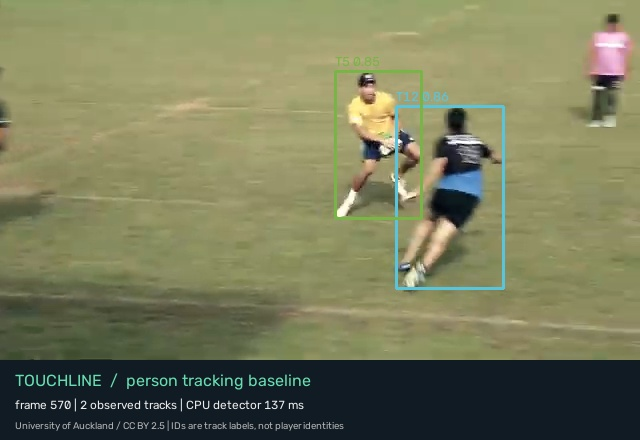

# Touchline: rugby video detection and tracking

An inspectable local pipeline for detecting people in touch-rugby footage, associating observations across frames, and measuring detection, identity and runtime failures.

**Start with [the annotated video](outputs/annotated.mp4)** or [the report screenshot](outputs/report-preview.png). Download this repository and open `outputs/report.html` in a browser for the playable report.



## What was built

- OpenCV DNN inference of pretrained YOLOX-S ONNX person detections, with verified input scaling, RGB order, padding and output decoding.
- Constant-velocity box prediction and Hungarian IoU association. High-confidence detections can create tracks; lower-confidence detections can recover existing ones. Missing observations are never exported as if observed.
- JSONL raw detections and tracks with source-frame indices and per-stage timings.
- A frozen, visually annotated diagnostic; separate detection precision/recall from tracked identity continuity.
- An H.264 video, an offline HTML report, provenance hashes and a reviewable annotation audit.
- Eleven meaningful tests covering weak detections, reordered input, missed frames, expiry, invalid assignments, identity switches, corrupted annotations and preprocessing.

The tracker is an explicit baseline, not a claimed implementation of SORT or ByteTrack. It has no appearance embeddings, camera-motion compensation, team labels or actual player identities. IDs apply within one continuous shot; reset the tracker between shots.

## Recorded run

Source: The University of Auckland's interfaculty touch-rugby video, 640x360, 25 fps. Frames **550–609**, 2.4 seconds. Labels: frames 550, 555, 560, 565, 570, 575, 580 and 585, covering 29 people-box observations and six distinct people. See [THIRD_PARTY.md](THIRD_PARTY.md) for source, licence and changes.

| Diagnostic | Observed result |
|---|---:|
| Detector matches at IoU >= 0.5 | 26 true positives, 3 false positives, 3 misses |
| Detector precision / recall | 89.7% / 89.7% |
| Tracked observation precision / recall | 92.6% / 86.2% |
| Observed ID switches | 1 across 19 matched identity links |
| Detector latency, median / p95 | 156 / 171 ms |
| Tracker latency, median | 0.28 ms |
| Processing loop | 6.4 fps on this CPU, four OpenCV threads |
| Final H.264 export | 0.33 seconds separately |

The detection counts concern raw detector outputs, including detections below the new-track threshold. Tracking has its own observed outputs, so its precision/recall differs. ID switches compare each ground-truth person's current matched track with its previous matched track, including after a labelled miss; this is a sparse-frame diagnostic, not MOTChallenge MOTA/IDF1. The report retains frame-level counts and both sets of rates.

Runtime is a single local observation, not a speed benchmark. The timed loop includes decoding, detector preprocessing/inference/postprocessing, tracking, rendering and intermediate MP4 encoding. It excludes model loading, a separate first-frame warm-up, final H.264 transcoding and report generation. The encoded video plays at the source's 25 fps; that playback rate is **not** processing throughput.

## Annotation protocol and limitations

[labels.json](evaluation/labels.json) and [freeze.json](evaluation/freeze.json) were saved before the first model inference. Labels were drawn by Codex through visual inspection, not independently human reviewed. The checksum is enforced during evaluation. No thresholds or labels were tuned after inspecting these results.

The evaluation scope is people whose box centre lies in `[30,30,610,320]` and visible box height is at least 40 pixels. It includes officials, and excludes distant people and edge-centred partial bodies. Both labels and predictions use that scope. Boxes describe visible extents rather than hidden body parts. A full-body detector can disagree with that convention under occlusion; the misses/false positives at frames 550–560 need human review. The shot was chosen for visible motion blur and overlapping players, not sampled as a representative dataset.

The ID switch is observed at frame 565, during a camera pan and crowded motion. Motion in image coordinates includes camera movement; no metre-per-second speed or athletic-performance assessment is computed. Performance on 29 labels does not establish whole-match, other-camera or other-sport accuracy. Eight sparse annotated frames can miss identity errors between samples.

## Reproduce on Windows

Use Python 3.12. From this folder:

```powershell
py -3.12 -m venv .venv
.venv/Scripts/python.exe -m pip install -r requirements-dev.txt
.venv/Scripts/python.exe prepare_assets.py --download
.venv/Scripts/python.exe -m pytest -q -p no:cacheprovider --basetemp .test-local
.venv/Scripts/python.exe -m rugby_track.run
```

The model and source video are downloaded separately rather than committed to Git. `prepare_assets.py --download` explicitly downloads and checksum-checks the pinned model and source video. The original source uses yt-dlp with Node.js for format extraction. Source availability may change. If a video re-encode changes its hash, the script stops: inspect frame correspondence before reusing frozen annotations. Model downloads are checked against the recorded upstream LFS SHA256. Tests and ordinary inference never access the network.

`rugby_track.run` accepts `--video`, `--model`, `--labels`, `--output`, `--start`, `--end` and `--threads`. Labels must have a matching `freeze.json` beside them; every labelled frame must have a prediction record. Defaults reproduce the recorded shot. For an alternative shot, use a separately frozen label file and explicitly reset/restart the tracker; do not mix identities across cuts. A new output folder requires copying or regenerating its annotation audit for the report link.

`requirements.txt` pins OpenCV, NumPy, SciPy and imageio-ffmpeg. `requirements-dev.txt` adds pytest and yt-dlp. Local browser QA used Playwright with an installed Microsoft Edge executable; Playwright is optional and not needed for inference or tests. On Linux/macOS use `.venv/bin/python` in place of `.venv/Scripts/python.exe`.

## Reviewable evidence

- [Run manifest and source hashes](outputs/run.json)
- [Metrics and prediction-file hash](outputs/metrics.json)
- [Raw detections and tracks](outputs/predictions.jsonl)
- [Frozen annotation audit](outputs/annotation-audit.jpg)
- [Browser video-playback check](outputs/browser-check.json)
- [Source and model licence](THIRD_PARTY.md)

Two useful next experiments are a separately annotated, longer continuous shot and a camera-motion/appearance-assisted tracker. They require fresh evaluation data rather than tuning repeatedly against this diagnostic. No new experiment is claimed as completed here.

## Licence

Code: Apache-2.0, see LICENSE and NOTICE. Source footage and derived visual assets retain CC BY 2.5 attribution; model-folder licence and source are recorded in THIRD_PARTY.md.
